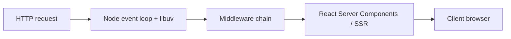

# Lecture 02: Node.js Internals, Defensive TypeScript, Next.js App Router

**Course:** AI-Enabled Software Engineering (Module 1)  
**Instructor:** Prof. Rohit Shubhra Chakraborty (CSE, IIT KGP)  
**Session focus:** Advanced (not absolute basics) JavaScript/TypeScript/Next.js patterns for safe, robust production code.

---

## Session map

| Module | Topics |
|--------|--------|
| **M1** | Node runtime, event loop phases, timers, `process.nextTick` / `setImmediate`, streams, pipe vs `pipeline`, Express middleware |
| **M2** | Strict TypeScript, generics, constraints, `keyof`, discriminated unions, `never` |
| **M3** | App Router, RSC/SSR, rendering modes, streaming SSR, Suspense, `loading.tsx`, `'use client'` |

**Stated outcomes:** Reason about event-loop and stream behavior in Node; design APIs with strict TypeScript; build App Router apps that stream, recover from errors, and ship minimal client JS.

---

## M1: Client → Node runtime



- **libuv** (transcript: “libuv” / “DBUV”): C library between JavaScript and the OS; translates JS calls into system calls (files, sockets) and synchronizes callbacks with the **event loop**.
- **Middleware:** Steps between request and response—logging, authorization, parsing, routing, error handling. Often implemented as `(req, res, next) => { ...; next(); }`.
- **App Router shift:** Less JS shipped to the browser; server sends rendered HTML; only marked client portions run in the browser.

---

## Event loop (most important conceptual topic in this lecture)

### Single-threaded “run to completion”

- JavaScript in Node runs **one thread** for your JS code—not one thread per connection like classic C network servers.
- I/O is delegated to libuv/OS; completion is handled **implicitly**, usually on a **later event-loop iteration**—not by preempting the current JS stack mid-function (unlike typical OS interrupt/time-slice models).
- **Pitfall:** Long synchronous CPU work or starving the loop blocks **all** pending I/O callbacks.

### Six phases (user-relevant order from lecture + quiz)

Continuous loop; each iteration runs:

1. **Timers** — `setTimeout` / `setInterval` callbacks whose time has elapsed  
2. **Pending callbacks** — deferred system callbacks (mostly internal; network-related in lecture)  
3. **Idle, prepare** — internal libuv use  
4. **Poll** — retrieve new I/O events; execute I/O callbacks (e.g. `fs.readFile` completion)  
5. **Check** — `setImmediate` callbacks  
6. **Close callbacks** — e.g. `socket.on('close')`

**Focus for exams:** timers, **poll**, and **check**.

```text
     ┌─────────┐
     │ Timers  │  setTimeout / setInterval
     └────┬────┘
          ▼
     ... pending, idle/prepare ...
          ▼
     ┌─────────┐
     │  Poll   │  fs.readFile, network I/O callbacks
     └────┬────┘
          ▼
     ┌─────────┐
     │  Check  │  setImmediate
     └────┬────┘
          ▼
     Close callbacks → next iteration
```

### `setImmediate` — name is misleading

**Example (sync script):**

```javascript
console.log('A');
setImmediate(() => console.log('B'));
console.log('C');
// Output: A, C, B
```

- Lines 1 and 3 run synchronously; line 2 **registers** a callback for the **next check phase**, it does not run immediately.
- After sync code, the loop reaches **check** and runs `B`.

### Inside I/O callbacks (`fs.readFile`) — `setImmediate` vs `setTimeout`

- `fs.readFile` completes in the **poll** phase.
- From inside that callback:
  - **`setImmediate`** → next **check** phase of the **current** iteration (check not reached yet).
  - **`setTimeout(..., 0)`** → **timers** phase of the **next** iteration (current timers phase already passed).
- **Result:** `setImmediate` runs **before** `setTimeout` in this pattern.
- **Guidance:** Inside I/O callbacks, prefer `setImmediate` to defer non-urgent work until after the current batch of I/O callbacks, but before the next full loop iteration—still “before” next-iteration timers.

### `process.nextTick` — highest priority, dangerous

- Runs **between** end of one loop iteration and start of the next—**before** the next timers phase.
- **`nextTick` queue must drain** before the event loop continues → recursive `process.nextTick` can **prevent the loop from advancing** → I/O starvation (demo: recursive `loop()` registering itself via `nextTick`).
- **Order demo:** sync `A`, two `nextTick`s (`B`, `C`), sync `D` → **A, D, B, C** (nextTick queue after sync, before loop proceeds normally).
- **Prefer:** `setImmediate` to chunk work across iterations so poll can still run.

---

## Streams and pipelines

### Mental model

- **Stream:** Data in **chunks** flowing through buffers; **pipeline stages** process sequentially (Unix `|` analogy: `ls -l | wc -l`).
- **Types:**
  - **Readable** — read-only source  
  - **Writable** — write-only sink  
  - **Duplex** — read and write (e.g. **TCP `net.Socket`**, client↔server)  
  - **Transform** — duplex that maps input → output (e.g. gzip, uppercase transform)

> **Note:** “Back pressure” appears in the module title; this transcript emphasizes chunk/pipeline flow, error propagation, and demos—not `highWaterMark` / `pause()` APIs. Treat backpressure as the general problem of matching producer/consumer speed when chunks flow through stages.

### `readable.pipe()` vs `stream.pipeline()`

| | `.pipe()` | `stream.pipeline()` (preferred) |
|---|-----------|----------------------------------|
| Error handling | Per-stream `'error'` handlers; stages may continue after upstream failure | Errors propagate; failed streams **destroyed**; cleanup “unwinds” pipeline |
| Demo lesson | Wrong input path: output stage may still try to run | Single catch: “pipeline failed” |

**Demo flow:** `input.txt` → uppercase transform → `output.txt`. Failures: missing file, bad output directory, both paths wrong.

**Middleware + streams:** Large JSON bodies may be handled with stream-based parsing/storage inside middleware (mentioned in lecture).

### Key APIs

- `fs.createReadStream`, `fs.createWriteStream`
- `Transform` for in-process mapping
- `stream.pipeline(...)` with `promisify` / async-await style (demo)
- `zlib.createGzip()` in multi-stage file compression example (`in.log` → `.gz`)

---

## Express middleware demo

- Server on `localhost:3000`.
- Auth middleware: HTTP call must include `token=secret` or request fails (401 / unauthorized).
- **`next()`** must be called to pass control—omitting it **hangs** the request.
- Logger middleware runs on requests (including favicon attempts).

---

## M2: Defensive TypeScript

### Why TypeScript + strict mode

- JavaScript lacks static types → runtime surprises.
- TypeScript adds types but still inherits JS footguns → use **`strict: true`** in `tsconfig.json` (or `tsc --strict`).

**Single-file demo flags:**

```bash
tsc --noEmit --strict --skipLibCheck --ignoreConfig strict-demo.ts
```

- `--noEmit` — typecheck only  
- `--ignoreConfig` — avoid conflict when a project `tsconfig.json` exists but you compile one file

### Strict checks illustrated in `strict-demo.ts` (anti-patterns)

| Flag / concept | Bad pattern | Why it fails under strict |
|----------------|-------------|---------------------------|
| Implicit `any` | `x * x` with untyped `x` | Multiplication on arbitrary `any` |
| `strictNullChecks` | `s.length` when `s: string \| null` | `null` has no `.length` |
| `noUncheckedIndexedAccess` | `numbers[10]` on length-3 array | Index may be `undefined` |
| Exact optional props | Assign `undefined` to optional `number` field incorrectly | Optional ≠ explicit `undefined` in strict reading |
| Uninitialized class fields | `id` never set in constructor | Missing initializer |
| `useUnknownInCatchVariables` | Treat `catch (e)` as typed message without narrowing | `e` is `unknown` |
| `noImplicitOverride` | Subclass method without `override` | Silent override confusion |
| `strictFunctionTypes` | Assign function taking `Dog` to one taking `Animal` | Parameter types are checked contravariantly |

**Lesson:** Write explicit parameter and return types; do not write “TypeScript as JavaScript.”

### Generics vs `any`

- `any` breaks **input ↔ output** relationship.
- Generic `first<T>(arr: T[]): T | undefined` preserves: `[1,2,3]` → `number | undefined`; `['a','b']` → `string | undefined`.
- **Stack\<T\>** demo: `Stack<number>` vs `Stack<string>` with same implementation; LIFO pop order.

### Constraints and `keyof`

- `longest<T extends { length: number }>(a: T, b: T)` — only types with numeric `.length` (arrays, strings); not plain numbers.
- `keyof T` — union of property names; `Pick`/helper patterns to access `obj[k]` safely.
- Generic with constraint `{ id: number }` — works on any object with `id`, not only named interfaces.

### Discriminated unions

- Shared **literal discriminator** (e.g. `status: 'idle' | 'loading' | 'success' | 'error'`) ties fields to variants—avoids impossible states (success without `data`, etc.).
- **Shape area example:** `kind: 'circle' | 'square' | 'triangle'` with different fields per kind; `switch (s.kind)` for area formulas.
- **`never` in `default`:** Assign `s` to `never` in exhaustive switch—if a new variant is added (e.g. `rectangle`) but `area()` not updated, **compile fails** (exhaustiveness check).
- Always include **`default`** in switches; with unions, default + `never` catches missing cases at compile time.

---

## M3: Next.js App Router

### Defaults (since v13+)

- **App Router is default.**
- **Server-first:** Render on server; send HTML; minimize client JS.
- **React Server Components (RSC):** Server components stay on server; errors can be isolated per route segment.

### File conventions

| File | Role |
|------|------|
| `layout.tsx` | Shell, auth wrappers, providers, shared chrome; **required** root layout |
| `page.tsx` | Route UI; **URL-specific data** belongs here |
| `loading.tsx` | Suspense **fallback** / placeholder while streaming segments load |

**Rule of thumb:** Changing content per URL → `page.tsx`; stable shell → `layout.tsx`.

### `'use client'`

- Default: Server Components (async server data fetching OK).
- **`'use client'`** at top of file → bundle runs in browser (e.g. `useState`, click counters).
- Push `'use client'` **as deep in the tree as possible**—everything imported below enters the **client bundle**.
- Avoid client rendering unless necessary (latency, bundle size).

### Rendering modes (lecture taxonomy)

1. **Static** — HTML built at build time; same for every client.  
2. **Revalidated** — Cached HTML, refreshed on an interval (e.g. 60s, 30 min) even if data unchanged.  
3. **On-demand** — Regenerate when author/user triggers (e.g. blog preview while editing).  
4. **Dynamic** — Per-user, no shared cache; cookies/headers; typical for e-commerce, travel, hotels.

### Streaming SSR + Suspense

- Problem: SSR still waits on slow DB/API (flights, hotels)—user sees blank page without streaming.
- **Streaming SSR:** Send **shell** first (nav, layout); slow sections **stream in** as ready.
- Wrap slow server components in **`<Suspense>`**; pair with **`loading.tsx`** placeholders (flight “searching” UI).
- **Demo (`/dashboard`):** Static shell + nav immediately; **SlowStats** ~2s; **SlowNews** ~5s—user sees progressive fill, not a dead page.

### Key takeaways (instructor closing)

1. **Event loop** — measure delays; don’t block; use streams for large payloads; avoid `nextTick` starvation.  
2. **Defensive TS** — strict compile, generics, discriminated unions; compile before deploy.  
3. **App Router** — server render + stream slow parts via Suspense; minimal `'use client'`.

---

## Pitfalls checklist (exam-oriented)

- Assuming `setImmediate` runs before the next synchronous line.  
- Assuming `setTimeout(0)` inside `readFile` runs before `setImmediate` in the same callback.  
- Recursive `process.nextTick` blocking poll/I/O.  
- `.pipe()` without coordinated error handling.  
- Forgetting Express `next()`.  
- Treating TypeScript as untyped JS (`any`, missing return types).  
- Adding union variants without updating exhaustive `switch` / `never` default.  
- Placing `'use client'` too high—bloated client bundles.  

---

## Hands-on (mentioned at end)

- Resource zip: three modules + `setup.md`; Node **LTS** from nodejs.org; VS Code or other editor. Not part of graded MCQ content but reinforces Module 1–2 exercises (streams, generics/queues).
